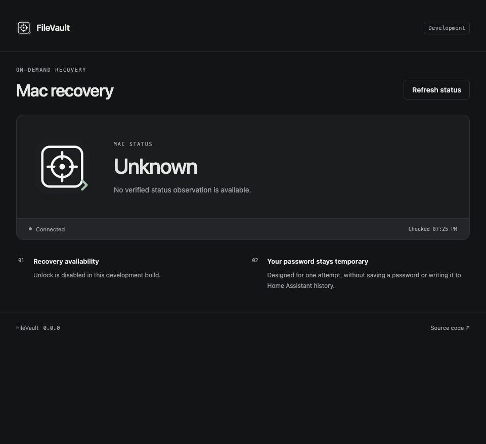

# FileVault

An experimental FileVault recovery app and read-only Home Assistant integration,
using the same Rust/Dropshot service, embedded UI, and Python coordinator
structure as [Maintenance](https://github.com/jessfraz/ha-maintenance) and
[Shipments](https://github.com/jessfraz/ha-packages).

**This prerelease has not been tested against a real Mac. Recovery is disabled
by default.** It requires supervised enrollment proving that preboot and normal
runtime have distinct, independently trusted SSH host keys. Shared phase keys
are unsupported. There is no automatic banner detector or trust-on-first-use.



Synthetic development preview. [Mobile
layout](docs/screenshots/status-mobile.jpg).

## What it does

- Verifies pinned SSH host identities and repeats preboot observations.
- Offers a masked, temporary password field only for a verified locked state.
- Rechecks the same connection with a fresh SSH key exchange, then submits one
  password authentication request. No shell, commands, PTY, forwarding, method
  fallback, or automatic retry.
- Confirms normal runtime with a new handshake to its separately enrolled key.
  Authentication completion or SSH disconnect alone never means success.
- Exposes a fixed read-only status sensor through the optional HA integration.
  A Mac password never enters HA entities, services, events, or automation data.

Apple supports FileVault unlock over SSH on Apple silicon with macOS 26 or
later,
Remote Login enabled, and network connectivity. See
[Apple's documentation](https://support.apple.com/guide/security/managing-filevault-sec8447f5049/web).
Apple does not promise the distinct phase identities this profile requires;
supervised calibration must establish that fact for the actual target. If it
cannot, leave recovery disabled. Do not substitute a version/banner guess.

"Running" means the enrolled normal SSH runtime identity is reachable. It does
not certify a desktop login or the health of every user application. Check
required services separately after a supervised test.

## Home Assistant app

Install only after reviewing the exact prerelease, image digest, permissions,
and hardware test plan. The executor must run independently of the locked Mac.
No installation or power cycle is performed by this repository.

Add this repository URL to the HA app store, select FileVault, and review its
configuration before starting it. The multiarch image is
`ghcr.io/jessfraz/ha-filevault:<version>`. Published prereleases are
experimental.

- `auto_pairing`: on by default for the HA app. On approved app startup it
  creates/reuses one owner-only read-only service credential and announces it
  privately through Supervisor. Confirm the discovered integration in HA before
  its credential is probed or saved in Core. No Mac password participates.
- `allowed_user_ids`: explicit HA users permitted through authenticated ingress.
  Empty denies access. The configured Supervisor peer is also checked.
- `frontend_origin`: exact HTTPS browser origin, without a path or trailing
  slash.
- `status_token`: explicit 32–256-character read-only service credential for
  manual/standalone use with `auto_pairing: false`. Empty disables that API
  when automatic pairing is off. **Never enter a Mac password here.**
- `ssh_recovery`: target host/port/local account, preboot and runtime public
  keys,
  `enabled`, and `manual_enrollment_verified`. Both flags default to false.
  Do not mark enrollment verified without the supervised checks in
  [SECURITY.md](SECURITY.md). Recalibrate after OS or SSH identity changes.

The app uses managed `/data`, runs as UID 10001 after initial ownership setup,
and exposes ingress on 8099. It requests no privileged mode, host networking,
Docker socket, host mounts, devices, HA Core API token, or Supervisor-management
API. It uses only the standard app self-info and discovery routes for pairing.
Core dumps are disabled. The optional bearer status API uses internal port
8080; its host mapping is disabled by default. Do not expose it casually.

## HACS status integration

Add `https://github.com/jessfraz/ha-filevault` as a HACS custom repository of type
Integration. This is **not** a default-catalog listing. HACS installs the Python
adapter, not the backend. Installing custom Python executes it inside HA Core;
review that trust boundary separately from the container app.

The app generates a read-only integration credential in `/data/credentials.json`
with owner-only permissions and reuses it across restarts. It announces only
that credential and its Supervisor-provided internal origin through
authenticated
Supervisor discovery. HA shows a confirmation form before any credential probe
or config-entry write. Reauthentication rediscovers the same app and confirms
replacement. This matches the reference apps' automatic pairing flow.

For a standalone service, choose the explicit standalone setup and enter its
origin and read-only integration credential. The client validates the role
through `/v1/system`, rejects broader owner credentials, and never redirects a
credential. No token is sent to the browser dashboard. FileVault deliberately
has no separate owner API credential: all unlock requests require the ingress
user/session/origin boundary, and its pairing token is read-only.

The integration uses HA's shared HTTP client and exposes one status sensor,
with bundled brand PNGs and state icons. It registers no unlock service.

For standalone development, `FILEVAULT_STATUS_TOKEN` enables the read-only
listener at `FILEVAULT_BIND` (default `127.0.0.1:8080`). The optional
`ssh_probe`
JSON profile performs a pinned handshake only and never enables recovery.
Use one SSH profile at a time. Private configuration stays outside the source.

## Development and release

Use Rust stable, Node.js, Python 3.14, uv, and just. `nix develop` provides the
reference tools. Run `just check`, `just security`, and `just container`.
`just openapi` regenerates the API document. Tests use ephemeral loopback SSH
servers and synthetic credentials; they do not establish real Mac behavior.

After committing a reviewed candidate, run:

```sh
scripts/build-release-artifacts --output /tmp/filevault-release
```

This packages committed source and a standalone integration ZIP, license,
provenance, and SHA256SUMS. The image workflow builds/tests native amd64 and
arm64, then publishes only approved version tags when the repository release
gate is enabled. The version check rejects 0.0.0 and mismatched tags.

See [ARCHITECTURE.md](ARCHITECTURE.md) and [SECURITY.md](SECURITY.md) for
request,
credential, enrollment, and release boundaries. Issues and wiki are disabled;
submit improvements through pull requests with fictional fixtures.

## License

MIT. Original icon assets and reused reference styles retain this license and
its copyright notice.
