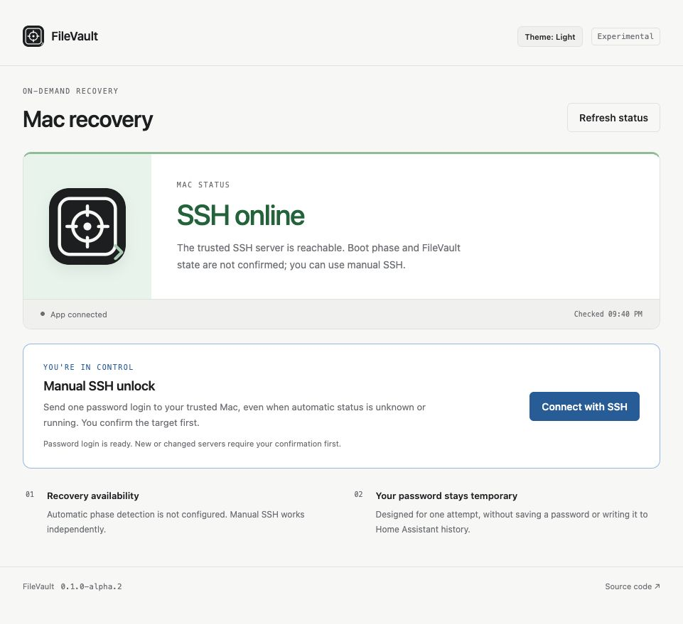

# FileVault

Password-based SSH unlock for Home Assistant, with one Mac profile, an optional
Tailscale running check and optional boot-phase suggestions. It follows
[Maintenance](https://github.com/jessfraz/ha-maintenance) and
[Shipments](https://github.com/jessfraz/ha-packages): Rust/Dropshot, an embedded
light/dark UI, HA ingress, and a read-only Python integration.

Manual SSH recovery has been validated through repeated supervised Mac unlocks.
The manual feature uses host, port, username, and a password entered for one
attempt. It does not require client-key authentication or copied phase keys.
It does not open an interactive terminal.



Synthetic preview. [Mobile layout](docs/screenshots/status-mobile.png),
[dark theme](docs/screenshots/status-dark.png), and
[server identity confirmation](docs/screenshots/manual-identity.png).

## One Mac connection

Enter the LAN hostname, optional Tailscale address, SSH port, and username once
in **Mac connection**. The same profile drives manual password SSH, automatic
LAN observations, and the optional Tailscale running check. There is no separate
manual host, username, port, or authentication group.

```json
"mac": {
  "host": "mac.example.invalid",
  "tailscale_host": "<machine>.<tailnet>.ts.net",
  "port": 22,
  "username": "your-account",
  "manual_enabled": true
}
```

Use the Mac's actual full tailnet hostname (or its Tailscale IP). The example is
a placeholder; replace both angle-bracketed values. Existing HA routing, DNS,
and tailnet permissions must already allow the connection; the app adds no
membership, ACL, DNS, or network grant.

### Check connections before signing in

**Check connections** tests both configured hosts from the FileVault app's own
network namespace. It reports DNS resolution, TCP port reachability, and SSH
server identity separately. A DNS failure means TCP and SSH were not attempted.
A reachable port with an unrecognized SSH key reports identity verification
needed. It never saves that identity or sends an SSH authentication request.

Checks use the same shared SSH port and the app's system resolver, with no
alternate resolver, numeric fallback, caller-supplied target, or password.
The two hosts are checked independently, with bounded DNS/TCP/SSH timeouts,
at most four TCP candidates each, and one check in flight. Results and the
app's resolver IPs are available only to authenticated same-origin ingress;
the integration token cannot access this endpoint. These checks do not update
the Mac's boot-phase state or replace the manual recovery confirmation flow.

Connection checks persist in SQLite under `/data/filevault.sqlite3` in the app,
using the same SQLx, embedded migration, WAL, and transactional-write pattern
as Shipments and Maintenance. Outside the app, `--database` or
`FILEVAULT_DATABASE` selects the path. The service starts checks automatically,
without an open UI. `FILEVAULT_CHECK_INTERVAL_SECONDS` (15–300, default 60)
sets the completion-relative cadence. Failures back off to at most 300 seconds;
manual and scheduled checks share one non-queueing probe lock. Shutdown stops
scheduling and drains the accepted check before closing SQLite.

New observations expire after `FILEVAULT_HISTORY_DAYS` (1–90, default 14),
with a safety cap of 100,000 new records. Expiry is assigned on insertion;
changing the setting affects future observations. Legacy records have no
expiry and are preserved. Cleanup runs only while recording checks, never
on startup. The latest observation and last successes survive restarts.
Missing, incomplete, future-dated, or ten-minute-old results indicate an
unknown current connection. DNS failure or Tailscale absence never establishes
FileVault lock. Disconnection/reconnection time is bounded approximately by
the surrounding observations, rather than an exact device event timestamp.
The ingress-only history API returns matching endpoint settings, newest first,
with keyset pagination.
Last SSH reached and last identity verified cover retained history only.
Changing either endpoint or the shared port selects a separate history.

Saved records contain server timestamps, sequence, run state, DNS/TCP/SSH
outcomes, fixed error categories, and a configuration hash. They contain no
hostnames, IP addresses, usernames, passwords, tokens, host keys, resolver
configuration, or raw diagnostics. Interrupted runs remain interrupted after
restart. An accepted check finishes and saves its bounded result if the browser
stops waiting; it never authenticates or retries a login.

While the Mac is currently confirmed Running, SSH activity, connection checks,
and manual SSH unlock sit below the main controls as click-to-expand sections,
following Shipments' installation section. Active recovery and current failures
stay expanded and prominent. When Running is no longer confirmed, the tools
expand in their usual positions, even if saved connection checks passed. Saved
history never establishes Running. Checks continue while sections are collapsed.

When a MagicDNS name fails here, inspect DNS forwarding from the app network
namespace. A successful lookup from a different HA app does not establish the
FileVault container's behavior. A `.local` name also depends on that namespace's
mDNS support. Diagnose the failing layer before changing network or DNS settings.

## Manual password SSH

Open **Connect with SSH** in authenticated ingress. It uses the shared profile's
LAN target even when automatic status is unavailable, unknown, or running.
Recognized servers proceed to account confirmation and temporary password
entry. A new or changed server displays its fingerprint and requires a separate
explicit identity-verification step before password entry. The confirmation is
a working button flow, not an instruction to copy a key into another setting.

Server identity verification is different from client-key authentication.
Manual login uses one ephemeral password and does not require a client key.
Public server identities persist in owner-only /data/ssh_known_hosts.
You can verify the identity and cancel before entering any password; automatic
checks can then use that trusted identity without a login password.

The retained cryptographic connection and any rekey use the selected identity.
There is no reconnect, shell, command, PTY, forwarding, method fallback, or
automatic password retry. After authentication, disconnect, or authentication
timeout, the app waits up to two minutes for a fresh verified runtime response.
It reports Running only after that response. Otherwise it reports whether SSH
accepted the password, disconnected, or timed out without confirming startup.
If no runtime check is configured, authentication stays unconfirmed immediately.

The SSH activity panel shows authentication, startup checks, and the final
result while the operation runs, including after returning to the page. Its
diagnostics contain fixed messages, never passwords or raw server output.
Cooldown has its own countdown and retry time; connection failures are separate.

## Automatic running checks

The optional Tailscale check makes a fresh SSH handshake to the shared profile's
Tailscale address and SSH port, requires an actual tailnet peer address, and
matches the server identity against the same trusted LAN identity store. It
uses no account authentication, password, client key, controller API, or cached
peer-online flag. A fresh verified response is positive normal-runtime evidence
and reports Running. It does not prove desktop login or application health.

DNS failure, timeout, missing identity verification, or unreachable tailnet is
reported distinctly. Failure may mean the Mac needs unlocking, or networking
may be unavailable. When trusted LAN SSH responds while Tailscale is offline,
the UI shows Locked and offers manual SSH unlock. This is the recovery display
rule; it does not enable the separate verified-preboot credential path.
Old observations cannot establish Running. A trusted LAN handshake by itself
means SSH online.

The Tailscale path relies on the existing Mac's normal-OS Tailscale service.
Its actual cold-boot availability and the app container's route must be checked
in the deployed environment. Wi-Fi presence is not used as unlock evidence.

**Advanced FileVault preboot suggestions** are separate optional evidence
settings, with no duplicate connection target. Missing preboot enrollment is a
setup note and does not invalidate the Mac connection or Tailscale check.
Distinct independently verified phase identities and supervised enrollment
remain required for the advanced classifier; shared phase keys cannot classify
boot phase. A normal-runtime observation never fabricates preboot enrollment.

Apple supports FileVault SSH unlock on Apple silicon with macOS 26 or later,
Remote Login enabled, and networking:
[Apple documentation](https://support.apple.com/guide/security/managing-filevault-sec8447f5049/web).
Compatibility still depends on the Mac, macOS version, and deployed network path.

## Upgrade from alpha.1 or alpha.2

This is a breaking configuration change, blocked from unattended app updates.
Supervisor filters removed schema fields before writing runtime options, so an
HA upgrade needs a preflight migration of its original saved options.

```sh
filevault --migrate-options original.json --migration-output canonical.json
```

The command writes one new mode-0600 output, preserves the original bytes, and
never prints option values. Keep both files private because existing read-only
integration credentials may be included. It refuses conflicting targets,
unsupported password fields, and malformed input. It never selects a divergent
target silently or changes a provider itself.

The HA mutation owner exports the current options privately before updating,
runs this command, then applies the canonical options through Supervisor after
the new schema is installed. Preserve app data and existing trusted identities.
Do not restart unrelated apps. Standalone runtime parsing accepts legacy input
with the same conflict rules, but it does not rewrite Supervisor-managed files.
See [app instructions](filevault/DOCS.md) for verification.

## Home Assistant app and pairing

Add `https://github.com/jessfraz/ha-filevault` to the HA app-store repositories.
Review the exact version, image digest, permissions, and target before
installing or updating. The app image is
`ghcr.io/jessfraz/ha-filevault:<version>`, native amd64 and arm64.

- `allowed_user_ids`: explicit HA users permitted through ingress; empty denies
  access. The configured Supervisor peer is also checked.
- `frontend_origin`: exact HTTPS browser origin, without path or trailing slash.
- `mac`: the single shared connection, with optional Tailscale address.
- `automatic`: optional advanced phase evidence, with no connection fields.
- `auto_pairing`: on by default. Approved startup creates/reuses a mode-0600
  read-only integration credential in `/data/credentials.json` and announces it
  privately through authenticated Supervisor discovery. HA confirmation occurs
  before credential validation or storage in Core. This is not a Mac password.
- `status_token`: optional 32–256-character service credential for explicit
  standalone pairing with `auto_pairing: false`. Never put an account password
  here. Empty disables that API when automatic pairing is off.

The app uses managed `/data`, initial ownership setup then UID 10001, ingress
8099, and an optional internal read-only API on 8080 with host mapping disabled.
It requests no privileged mode, host networking, Docker socket, host mounts,
devices, Core API token, or broad Supervisor API. Pairing uses only standard
self-info and discovery routes. Core dumps are disabled.

The executor, remote ingress, and recovery controller must survive loss of the
Mac. Review deployed proxy logging/buffering with dummy data before real
password entry. The user enters it directly, with agent observation off.
Do not use this app's first unvalidated recovery attempt as its own fallback.

## HACS integration and icons

Add this repository as a HACS custom repository of type Integration. This is
**not** a default-catalog listing. HACS installs the read-only Python adapter,
which runs inside HA Core; review that trust boundary separately. App ingress
can be used without it. Coordinate any required Core restart.

The app and integration use identical 256-pixel brand icons and matching
512-pixel assets. The integration bundles `brand/icon.png` and `icon@2x.png`;
the HA app includes `icon.png` and `logo.png`. The standard app sidebar uses
its matching Material Design vault icon. Packaging checks enforce identical
PNG assets and dimensions.

The integration confirms Supervisor discovery, validates the integration role
through `/v1/system`, rejects owner credentials and redirects, and stores only
the read-only service credential. It exposes one enum sensor and no SSH/unlock
service, password-bearing entity, automation bridge, or transcript.

## Ask Assist

Expose the FileVault status sensor to Assist and use an agent with the Device
control API enabled. Two explicit read-only tools are available:

- `filevault__status`: latest status, freshness and capability flags.
- `filevault__configuration_health`: capability flags and error/setup-note
  counts.

Both take no arguments. Each call rechecks exposure, the active HA user's read
permission, and the loaded integration. They use the existing cache without a
new network request. Failed polls or observations older than 30 seconds return
unknown/unavailable. Connection identifiers, raw messages, tokens, host keys
and passwords are excluded. Voice requests without a user context are refused.
No model-provider account, credential, unlock or power tool is added. This uses
HA's native [LLM tool platform](https://contributors.home-assistant.io/core/internals/llm-api/).

## Native diagnostics

Use **Download diagnostics** on FileVault in Devices & services. The integration
returns an allowlist of status flags, observation age, configuration counts and
entry state. Connection and credentials are redacted; entry data, titles,
identifiers, unknown future fields, raw messages and exceptions are omitted.
Downloading makes no backend request. HA adds its standard environment metadata
around this integration payload.

## Notification blueprints

Import a blueprint in **Settings → Automations & scenes → Blueprints**, then
choose the FileVault status sensor and notification actions. Nothing is
installed or enabled automatically. The YAML is included in the source archive:

- [Needs attention](blueprints/automation/filevault/needs_attention.yaml): notify
  after two minutes of an attention state; cooldown defaults to 30 minutes.
  Short flaps, attribute changes and initial entity creation stay quiet.
- [Runtime available again](blueprints/automation/filevault/running_again.yaml):
  notify after a transition to Running remains stable for 30 seconds, with a
  configurable 10-minute cooldown.
- [Daily status](blueprints/automation/filevault/daily_status.yaml): digest at a
  chosen local time (08:00 by default). Running stays quiet unless enabled.
  A two-hour cooldown suppresses repeated local times during DST fallback.

Notification fields can use `{{ title }}`, `{{ message }}` and `{{ status }}`.
Choose notification actions only. No blueprint uses a password, unlock request,
restart or power-cycle action. Missing status never proves locked; Running does
not prove desktop or application health. Debounce resets on automation reload;
cooldown uses HA's `last_triggered` state.

## Native read-only CLI

`ha-filevault` is a separate Rust client, not the `filevault` server. It reads
only the external integration API, never HA ingress. Build or run it with Nix:

```sh
nix build .#ha-filevault
nix run .#ha-filevault -- --help
# The default package and app are also ha-filevault:
nix run . -- --version
```

Provision a dedicated client-side file containing the read-only integration
service token through the existing secret-management workflow. It must be an
owner-only regular file (mode 0600 or 0400), containing 32–256 ASCII graphic
characters with an optional final LF or CRLF. This is a raw token, not the app's
JSON credential file, an HA access token, an owner credential, or a Mac password.
The CLI does not discover, create, rotate, or save credentials.

```sh
export HA_FILEVAULT_URL=https://filevault.example.invalid
export HA_FILEVAULT_TOKEN_FILE="$HOME/.config/ha-filevault/integration-token"
ha-filevault system
ha-filevault status
# Equivalent explicit native configuration:
ha-filevault --url https://filevault.example.invalid \
  --token-file "$HOME/.config/ha-filevault/integration-token" status
```

Use the origin of an already configured external API listener, without a path,
query, fragment, or URL credentials. No listener, host-port mapping, proxy,
network grant, or deployment is added. HTTPS uses normal certificate validation;
HTTP is supported only for an already trusted network because the service token
would otherwise travel in cleartext. Ambient HTTP proxies are not used.
`HA_FILEVAULT_*` settings are distinct from the server's `FILEVAULT_*` settings.
No token-value command-line option or server-configuration fallback exists.

| Command | One authenticated request | Output |
| --- | --- | --- |
| `system` | `GET /v1/system` | Complete typed integration system response |
| `status` | `GET /v1/status` | Complete typed integration status response |

Each invocation sends one bearer-authenticated GET, with no preflight, redirect,
retry, ingress headers, cookies, or request body. `system` requires the response's
`integration` credential role. `status` calls the existing fresh-observation
endpoint, which can perform the server's normal password-free SSH handshake;
read-only does not mean a cached-only observation. Running is not desktop or
application-health proof, and an unavailable observation does not prove lock.

Success emits the complete typed integration API response as one JSON object
on stdout, preserving the server's version, configuration errors/notes, decision
and capability fields without inferring new business decisions. Integration
connection data remains `null`, as required by the existing server boundary;
owner connection details and unrecognized status enums cause a safe failure.
Errors preserve HTTP status with fixed stderr diagnostics and nonzero exit status
(2 for invalid arguments, 1 for runtime/configuration failure). The request has
a 15-second timeout and a 64-KiB response limit. Help and version are offline and
do not display configured values.

There are deliberately no unlock, manual connection check, connection history,
recovery activity, identity/trust, session, password, owner, arbitrary-path, or
mutation commands. The server and its ingress guards are unchanged.

For development, run `nix develop -c cargo run -p ha-filevault -- --help` and
`nix develop -c cargo test --locked -p ha-filevault`. The root Cargo default
member remains the server: `cargo run -- ...` still runs `filevault`.

## Development and release

Use Rust stable, Node.js, Python 3.14, uv, and just. `nix develop` supplies the
reference tools. Run `just check`, `just security`, and `just container`.
`just openapi` regenerates the API description. CI runs frozen uv, Ruff, ty,
pytest, Rust tests/lints, browser checks, and native amd64/arm64 container
smoke.
All SSH tests use ephemeral loopback peers and synthetic credentials.

With librsvg installed, run `scripts/render-brand` to regenerate transparent
light/dark integration PNGs and matching app icon/logo from `web/brand.svg`
and `web/brand-dark.svg`. Flat outlines and neutral fills match Shipments
and Maintenance. No sibling assets are modified.

After committing a reviewed candidate, package it with:

```sh
scripts/build-release-artifacts --output /tmp/filevault-release
```

The source archive, integration ZIP, provenance, and SHA256SUMS contain
committed
public source only. Image publication requires an approved matching version tag
and the release gate. No deployment, password attempt, or power cycle is
performed by publication.

See [SECURITY.md](SECURITY.md), [ARCHITECTURE.md](ARCHITECTURE.md), and the
[app configuration guide](filevault/DOCS.md). Issues and wiki are disabled;
submit improvements with fictional fixtures through pull requests.

## License

MIT. Original icon assets and reused reference styles retain the license and
copyright notice.
